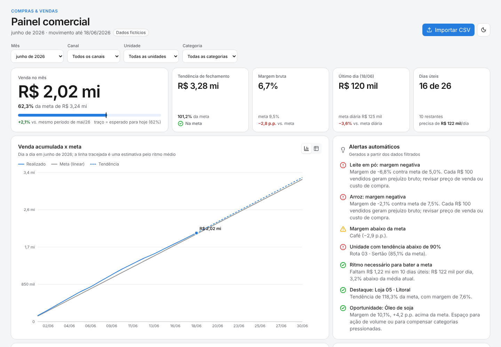

# Painel comercial · Compras & Vendas

Dashboard para acompanhar **venda, meta e margem bruta** de uma operação com lojas de varejo e rotas de venda externa, por unidade e por categoria de produto.

Ele foi pensado para a rotina de quem trabalha em compras ou na área comercial: saber onde o mês vai fechar, quais categorias estão comendo margem e quais unidades precisam de atenção, sem montar planilha todo dia.

**[Abrir a demonstração](https://lucascarreiro.github.io/dashboard-comercial-varejo/)**

> Todos os números são **fictícios**. Eles são gerados pelo script [`scripts/gerar-dados.mjs`](scripts/gerar-dados.mjs) com semente fixa, e nenhum dado vem de empresa real.



## O que o painel responde

- Quanto foi vendido no mês, quanto falta para a meta e onde deveríamos estar hoje pelo calendário
- **Tendência de fechamento**: projeção pelo ritmo médio dos dias úteis, sempre mostrada como estimativa
- **Margem bruta** realizada contra a meta, no total, por categoria e mês a mês
- Ranking de lojas e rotas pela projeção em % da meta
- **Alertas automáticos** calculados a partir dos dados: categoria com margem negativa, margem abaixo da meta, unidade abaixo de 90% e venda diária necessária para bater a meta

## Funcionalidades

- Filtros de mês, canal, unidade e categoria, que valem para a página inteira
- Clique numa unidade ou categoria para filtrar por ela
- Todos os gráficos têm tooltip e podem virar tabela (ícone no canto do cartão)
- Mapa de calor da margem por categoria × mês
- Tema claro e escuro
- **Importar CSV**: carregue seus próprios `vendas.csv` e `metas.csv`. O processamento acontece só no navegador e nada é enviado para lugar nenhum.

## Regras de cálculo

| Indicador | Como é calculado |
|---|---|
| Dias úteis | Segunda a sábado (feriados não são descontados) |
| Tendência de fechamento | Venda acumulada ÷ dias úteis decorridos × dias úteis do mês. Em mês fechado, é o próprio realizado. |
| Margem bruta | (venda − custo) ÷ venda |
| Meta de margem consolidada | Média das metas de margem, ponderada pela meta de venda |
| Comparação com o mês anterior | Mesmo número de dias úteis nos dois meses |
| Status | ≥ 100% da meta: na meta · 95–100%: atenção · 90–95%: abaixo · < 90%: crítico. Margem negativa é sempre crítico. |

## Formato dos arquivos

**vendas.csv**: uma linha por dia, unidade e categoria.

| data | canal | unidade | categoria | venda | custo |
|---|---|---|---|---|---|
| 2026-06-01 | Varejo | Loja 01 · Centro | Arroz | 3051.68 | 2814.40 |

**metas.csv** (opcional): uma linha por mês, unidade e categoria.

| mes | canal | unidade | categoria | meta_venda | meta_margem |
|---|---|---|---|---|---|
| 2026-06 | Varejo | Loja 01 · Centro | Arroz | 84391.59 | 8.5 |

Os valores aceitam ponto ou vírgula como separador decimal (`1234.56` ou `1.234,56`).

## Como rodar

```bash
npm install
npm run dev      # ambiente de desenvolvimento
npm run dados    # gera de novo os CSVs fictícios em public/dados
npm run build    # versão de produção em dist/
```

## Tecnologias

React 19 · TypeScript · Vite · Tailwind CSS 4 · Recharts · PapaParse

```
src/
  lib/dados.ts       leitura e validação dos CSVs
  lib/calculos.ts    tendência, margens, rankings e alertas
  lib/formato.ts     moeda, percentuais e datas em pt-BR
  components/        indicadores, gráficos, tabelas e alertas
scripts/
  gerar-dados.mjs    gerador dos dados fictícios
```

## Histórico

A versão 2 é uma reescrita completa de um protótipo de 2025. Ela tem dados fictícios, cálculos explícitos, alertas gerados a partir dos dados, importação de CSV e tema escuro.

---

Feito por **Lucas Carreiro** · [LinkedIn](https://www.linkedin.com/in/lucas1carreiro1/)
